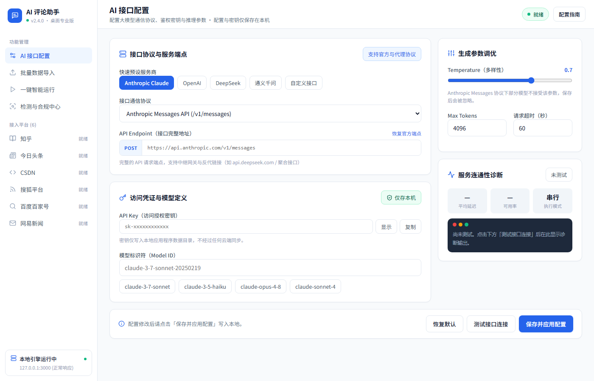
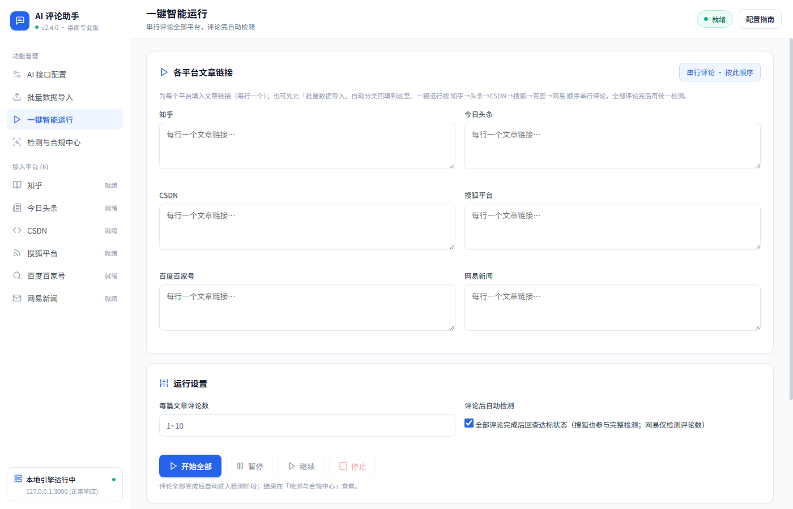
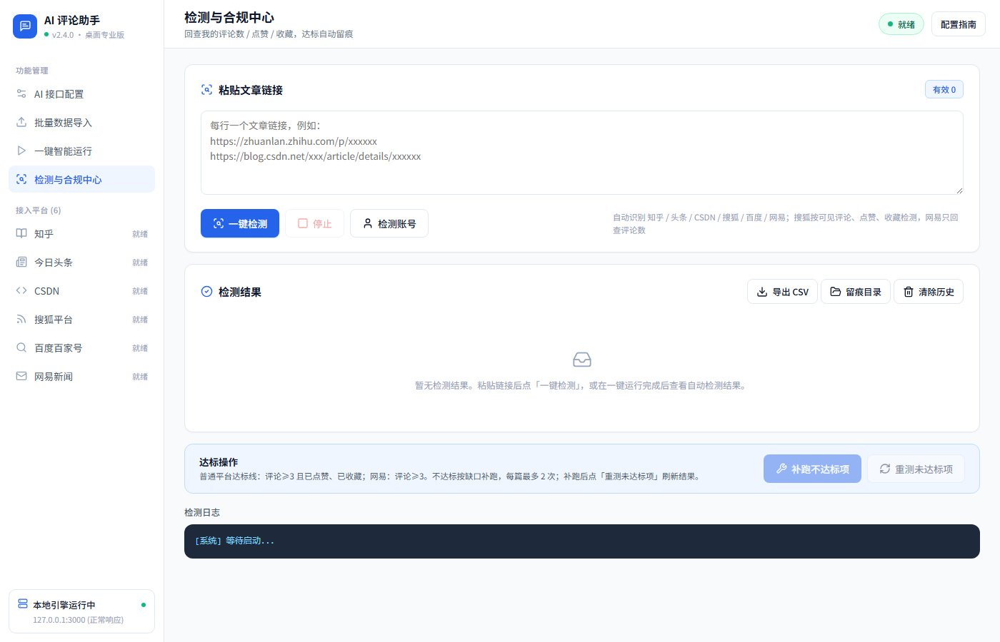

# AI 评论助手

> 桌面端工具：用 AI 给文章生成「提问式评论」，自动在 **知乎 / 今日头条 / CSDN / 搜狐 / 百度百家号 / 网易** 发布评论并点赞收藏；同时支持事后**回查检测**（我的评论数 / 点赞 / 收藏 / 达标判定 / 自动补跑 / 留痕截图）。


---

## ⚠️ 免责声明（请先阅读）

本项目仅用于**个人对自己账号的日常互动与自检**。使用前请务必确认：

- 自动化操作**可能违反目标平台的用户协议**，可能导致账号被限流、禁言或封禁，**后果由使用者自负**。
- **严禁**用于刷量、水军、虚假流量、商业推广灌水、操纵舆论、不正当竞争等用途。
- **严禁**将本软件（含修改版）用于**对外提供有偿服务** —— 代刷评论 / 代刷量 / 代点赞收藏 / 代运营 / 按条计费的评论投放，或包装成工具对外收费。
- 使用者须自行确保行为符合所在地法律法规及平台规则。

> 许可证为 MIT：**代码可自由商用**（MIT 允许），但上述被禁止的**用法**不论商用与否都不允许 —— 版权许可不豁免遵守平台规则与法律的义务。

完整条款见 **[DISCLAIMER.md](DISCLAIMER.md)**。继续使用即表示你已阅读并同意。

> 界面操作步骤请看 **[使用说明.md](使用说明.md)**（安装、首次使用、各功能与常见问题）。

---

## 截图

| AI 接口配置 | 一键智能运行 | 检测与合规中心 |
|---|---|---|
|  |  |  |

---

## 功能

### 自动评论
- 6 个平台，**每个平台独立登录会话**（持久化浏览器 profile，首次手动登录后免登录）。
- 每篇文章可设评论数；评论前自动点赞 + 收藏。
- AI 根据文章正文生成**提问式**评论（提一个针对性问题，而非吹捧或复述原文）。

### 一键智能运行
- 一次填入各平台链接 → 串行评论全部平台 → 评论完成后**统一检测**。
- 评论过程支持**暂停 / 继续**（从当前位置继续，不重启、不丢进度）。

### 批量数据导入
- 粘贴链接或上传 Excel（`.xlsx / .xls / .csv`），自动识别平台并分类回填到各平台输入框。

### 检测与合规中心
独立检测页（不必先评论也能用）：
- 粘贴链接自动识别平台并分类 → **一键检测**。
- 结果表：平台 / 文章链接（可点击用系统浏览器打开）/ 我的评论数 / 点赞 / 收藏 / 达标状态 / 操作。
- **达标判定**：普通平台为「评论 ≥ 3 且已点赞、已收藏」；网易为「评论 ≥ 3」（文章级点赞/收藏不适用）。
  🟢 达标 / 🔴 不达标（标出缺什么）/ ⚪ 待核对 / ⚠ 已失效(404)
- **补跑不达标项**：自动给不达标文章再跑一遍评论 + 点赞 + 收藏（评论按缺口补到 3），每篇最多 2 次，到上限转人工。
- **重测未达标项**：只重测不达标 / 待核对的，保留已达标行；404 文章自动排除。
- **多账号**：检测账号可填多个（逗号分隔），命中任意一个即算「我的评论」。
- 检测结果可导出 CSV；达标文章可**留痕截图**存证。

---

## 平台支持

| 平台 | 自动评论 | 评论数检测 | 点赞检测 | 收藏检测 |
|------|:--:|:--:|:--:|:--:|
| 知乎 | ✅ | ✅（评论 API） | ✅ | ✅ |
| 今日头条 | ✅ | ✅（评论 API） | ✅ | ✅ |
| CSDN | ✅ | ✅（评论 API） | ✅ | ✅ |
| 百度百家号 | ✅ | ✅（DOM 翻页） | ✅ | ✅ |
| 搜狐 | ✅ | ✅（可见评论 DOM） | ✅ | ✅ |
| 网易 | ✅ | ✅（评论 API，根跟贴 + 参与回复） | 不适用 | 不适用 |

> 搜狐只统计当前评论区**仍然可见**且账号名匹配的评论；页面加载或账号识别失败时返回「未知」，不会按 0 条自动补跑。

---

## 快速开始

### 方式一：直接使用（推荐）

1. 下载 `release/AI评论助手 Setup x.y.z.exe` 并安装。
2. 打开程序 → 进入「AI 接口配置」→ 选择服务商预设（Anthropic / OpenAI / DeepSeek / 通义千问 / 自定义）→ 填入 API Key 与模型 → **保存并应用配置** → 点「测试接口连接」确认连通。
3. 首次运行某平台任务时，会弹出浏览器，**手动登录一次**，会话会被记住。
4. 到「批量数据导入」或「一键智能运行」填入文章链接，开始运行。

> 安装包内置 Chromium，**用户端无需安装 Node.js**。

### 方式二：从源码运行

```bash
# 前置：Node.js 18+，Windows
npm install          # patchright 会下载 Chromium 到 pw-browsers/（约 400MB+）

npm start            # Electron 桌面窗口（与正式版一致）
npm run server       # 或：纯服务 + 系统浏览器打开 http://localhost:3000
```

---

## 配置

| 配置项 | 在哪改 | 说明 |
|---|---|---|
| AI 接口 | 程序「AI 接口配置」页 | 协议 / 地址 / 密钥 / 模型 / 生成参数。保存后**密钥不再回传明文**，页面只显示掩码；输入框留空即保持原密钥不变 |
| 检测账号 | 检测与合规中心 →「检测账号」弹窗 | 每平台可填多个（逗号分隔），优先于页面自动识别 |

- 桌面版运行时配置写在用户数据目录（`%APPDATA%/AI评论助手/`），与程序安装目录分离。
- `aiConfig.js` 是**种子模板**，入库请保持为空。开发模式下保存配置会写回该文件 —— **切勿把含真实密钥的 `aiConfig.js` 提交到 git**。

---

## 安全说明

- HTTP 服务**只绑定 `127.0.0.1`**，不对局域网暴露。
- `GET /api/config` **不回传明文密钥**：只返回掩码（如 `sk-ant••••••0abc`）与「是否已配置」标志。
- 登录会话（浏览器 profile）、检测结果、留痕截图均保存在**本机**。
- 密钥以明文存放在本地配置文件中（未做加密），请自行确保本机环境安全。

---

## 目录结构

```
.
├── main.js                    # Electron 主进程：探活并 fork 内置 server、开窗口
├── server.js                  # Express + Socket.IO：任务编排、配置、暂停/检测/状态接口
├── runner-registry.js         # 平台顺序常量 + 按通道定位 runner 的纯逻辑
├── pauser.js                  # 评论脚本的暂停/继续支持（进程消息）
├── detect.js                  # 检测模块：各平台检测器（自包含函数，供 page.evaluate 注入）
├── detect_netease.js          # 网易检测：评论 API 分页、去重与账号匹配
├── detect_runner.js           # 检测执行入口：逐篇检测，含 404 判定
├── evidence.js                # 留痕截图：抓取真实浏览器窗口（含地址栏）
├── aiComment.js               # AI 评论生成（chat / responses / messages 三格式）
├── aiConfig.js                # AI 接口配置（种子模板，请保持为空）
├── pinglun_*.js               # 各平台评论脚本
├── logger.js                  # 统一日志（控制台 + 落盘 logs/）
├── preload.js                 # 渲染进程桥接（只暴露窗口控制）
├── public/                    # 前端（index.html + app.js + xlsx 库 + 图标）
├── tests/                     # 轻量自检脚本（node 运行，非测试框架）
├── build/installer.nsh        # NSIS 安装包自定义脚本
├── docs/                      # README 用截图
├── pw-browsers/               # 内置 Chromium（不入库，打包用 extraResources）
├── pw-data-*/                 # 各平台浏览器用户数据（不入库，含登录态）
└── logs/                      # 运行日志（不入库）
```

---

## 开发

### 技术栈

| 层 | 选型 |
|---|---|
| 桌面壳 | Electron（无边框窗口，自绘标题栏） |
| 服务端 | Express + Socket.IO，由主进程以 `ELECTRON_RUN_AS_NODE` fork 启动 |
| 自动化 | [patchright](https://github.com/Kaliiiiiiiiii-Vinyzu/patchright) v1.61（Playwright 反检测分支，Apache-2.0）：在引擎层减少自动化特征，以降低被平台风控拦截的概率 |
| AI | Node 原生 `fetch`，兼容 OpenAI `chat` / `responses` 与 Anthropic `messages` |
| 前端 | 原生 JS 单页，无框架、无构建步骤 |
| 打包 | electron-builder + NSIS |

### 自检

```bash
npm test     # node tests/runner-registry.check.js
```

覆盖运行通道定位逻辑（暂停/继续必须精确命中目标平台）的 13 条断言，包含两条「旧实现会拿错」的对照断言。

### 打包

```bash
npm run dist -- --dir    # 免安装版 → release/win-unpacked/
npm run dist             # NSIS 安装包 → release/AI评论助手 Setup <版本>.exe
```

打包相关注意事项：

- `package.json` 里的 `"electronDist": "node_modules/electron/dist"` 用于绕过本机 electron-builder 缺少 `7zip-bin` 导致解压卡死的问题，**不要删除**。
- 内置 Chromium 通过 `extraResources` 随包（`pw-browsers/chromium-1228` → `resources/chromium-1228`）。
- `patchright` / `patchright-core` 通过 `asarUnpack` 解包。
- 若在受限沙箱/CI 中构建，输出目录**每次都要换新的**：electron-builder 打包前会清空产物目录，若该目录已存在且体积较大，删除可能超时导致中断。

---

## 常见问题

**Q：评论数检测为什么显示「未知 / 待核对」？**
按账号名匹配，平台未识别到账号名时会显示「未知」，不会误判为不达标、也不会被自动补跑。可在「检测账号」里手动填写。

**Q：暂停为什么不是立刻停？**
暂停粒度为「文章之间」：点暂停后当前文章会跑完，到下一篇之前停住。

**Q：会不会被封号？**
存在风险。建议每篇评论数控制在 1~3 条、保留足够间隔，并遵守平台规则。详见 [DISCLAIMER.md](DISCLAIMER.md)。

**Q：换电脑 / 换账号怎么办？**
程序内「检测账号」处修改匹配用的账号名；平台登录态保存在 `pw-data-<平台>/`，删除该目录即可退出登录重新登。

---

## 贡献

欢迎提交 Issue 与 PR。请注意：

- 不要提交任何真实密钥、登录态（`pw-data-*/`）、留痕截图或含个人账号信息的文件。
- 修改 `pinglun_*.js` 里的 `const <平台>UrlList` / `const perUrlCommentCount` / `const userDataPath` 这三处命名时，**必须同步修改 `server.js` 中 `runCommentPhase` 的注入正则**，否则任务会启动失败。

---

## License

[MIT](LICENSE) —— 允许自由使用、修改、分发，**包括商业使用**。

## 免责声明与使用限制

完整条款见 [DISCLAIMER.md](DISCLAIMER.md)。

请特别注意：MIT 许可的是**代码版权层面**的权利，**不豁免**遵守平台用户协议与所在地法律法规的义务。因此**严禁**将本软件用于刷量、水军、虚假流量、舆论操纵，也**严禁**将其（含修改版）用于对外提供代刷评论、代刷量、代运营等**有偿服务**。这类行为不论是否营利均被禁止。
